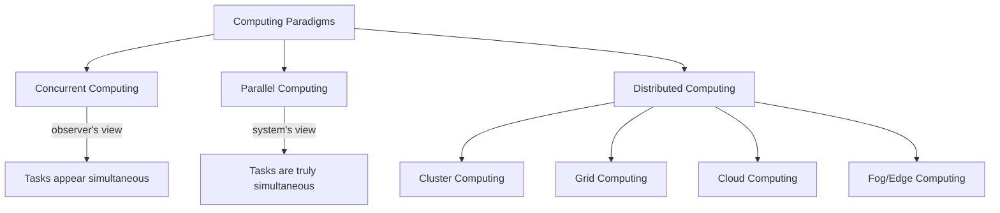

# Lecture 1 — Introduction to Concurrent Programming

> **Course**: COS40003 Concurrent Programming
> **Topic**: Introduction to Computing Paradigms

---

## Computing Paradigms Overview

There are several major computing paradigms related to concurrency:

- [[Concurrent Computing]]
- [[Parallel Computing]]
- [[Distributed Computing]]
- [[Cluster Computing]]
- [[Grid Computing]]
- [[Cloud Computing]]
- [[Fog/Edge Computing]]

---

## Concurrent Computing vs Parallel Computing

### In Everyday English
Both "concurrent" and "parallel" mean **happening at the same time**.

### In Computer Science

| Aspect | Concurrent Computing | Parallel Computing |
|---|---|---|
| **Perspective** | Observer/user's point of view | System/computer's point of view |
| **Definition** | Tasks *appear* to run simultaneously | Tasks *physically* run simultaneously |
| **Origin** | Developed on **single-processor** systems | Requires **multi-core / multi-processor** hardware |
| **Mechanism** | [[Time-Sharing]] (interleaving tasks) | True simultaneous execution |

> [!NOTE] Historical Context
> - Initially, computers had **only one CPU** → time-sharing and concurrency control were invented to simulate simultaneous execution
> - As technology advanced (multi-core, multi-processor), **true parallelism** became physically possible

### Key Concerns in Concurrent Computing
- **Time-Sharing / Scheduling** — how to improve response time while ensuring fairness
- **Concurrency Control**:
  - [[Race Conditions]]
  - [[Deadlocks]]

---

## Parallel Computing

> A type of computation in which many calculations or processes are carried out **simultaneously**.

### How It Works
1. A computational task is **broken down** into several similar subtasks
2. Subtasks are processed **independently**
3. Results are **combined** upon completion

### Examples
- **Multi-core CPU** — multiple cores on one chip
- **GPU Computing** — massively parallel processors for data-parallel tasks

---

## Distributed Computing

### Definition
No single universally agreed definition, but commonly accepted properties:
1. There are **several autonomous computers**, each with its own **local memory**
2. The computers communicate via **message passing**

### Parallel vs Distributed — Key Difference

| | Parallel Computing | Distributed Computing |
|---|---|---|
| **Memory** | Shared memory | Private/distributed memory |
| **Communication** | Through shared memory | Through message passing |

### Examples
- [[Cluster Computing]]
- [[Grid Computing]]

---

## Cluster Computing

> A number of **low-cost computers** connected via a **fast local area network (LAN)** to provide high-performance computing power.

- Typically **homogeneous** machines
- **Co-located** (same physical location)

---

## Grid Computing

> Many **networked, loosely coupled** computers acting together to perform large tasks.

- **Heterogeneous** machines
- **Geographically dispersed**
- Considered somewhat **outdated** — largely superseded by [[Cloud Computing]]

---

## Cloud Computing

### Goal
**Hide computation** at the server — users don't need to know the details of the underlying infrastructure.

### Service Models
- **SaaS** — Software as a Service
- **PaaS** — Platform as a Service
- **IaaS** — Infrastructure as a Service

> [!TIP]
> Cloud computing is not purely about distributed computing, but distributed computing techniques are important because they **support** cloud computing infrastructure.

---

## Fog / Edge Computing

### Goal
Perform as much processing as possible using computing units **co-located with or near the data-generating devices**.

### Key Application
- **Internet of Things (IoT)** — processing data at the edge reduces latency and bandwidth usage

---

## Summary

> [!IMPORTANT] Key Takeaway
> - **Concurrent** = from the **observer/user's** perspective, tasks appear simultaneous (may use time-sharing on a single CPU)
> - **Parallel** = from the **system/computer's** perspective, tasks are truly simultaneous (requires multiple processors/cores)
> - There is **no clearly defined boundary** between the two — understanding follows the history of technology development

---

## Lab 1 Task
- Read, understand, and summarize computing paradigms (concurrent, parallel, distributed, cluster, grid, cloud, fog/edge)
- Include as part of **Report I**
- Express own thoughts and (reasonable) disagreements with established ideas

---

#concurrent-programming #computing-paradigms #week1
