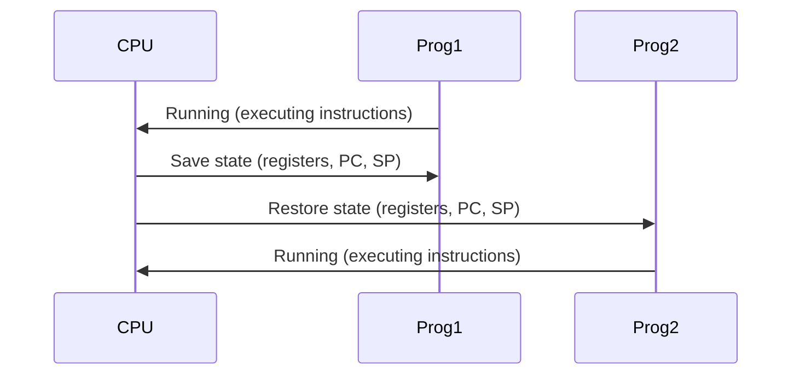
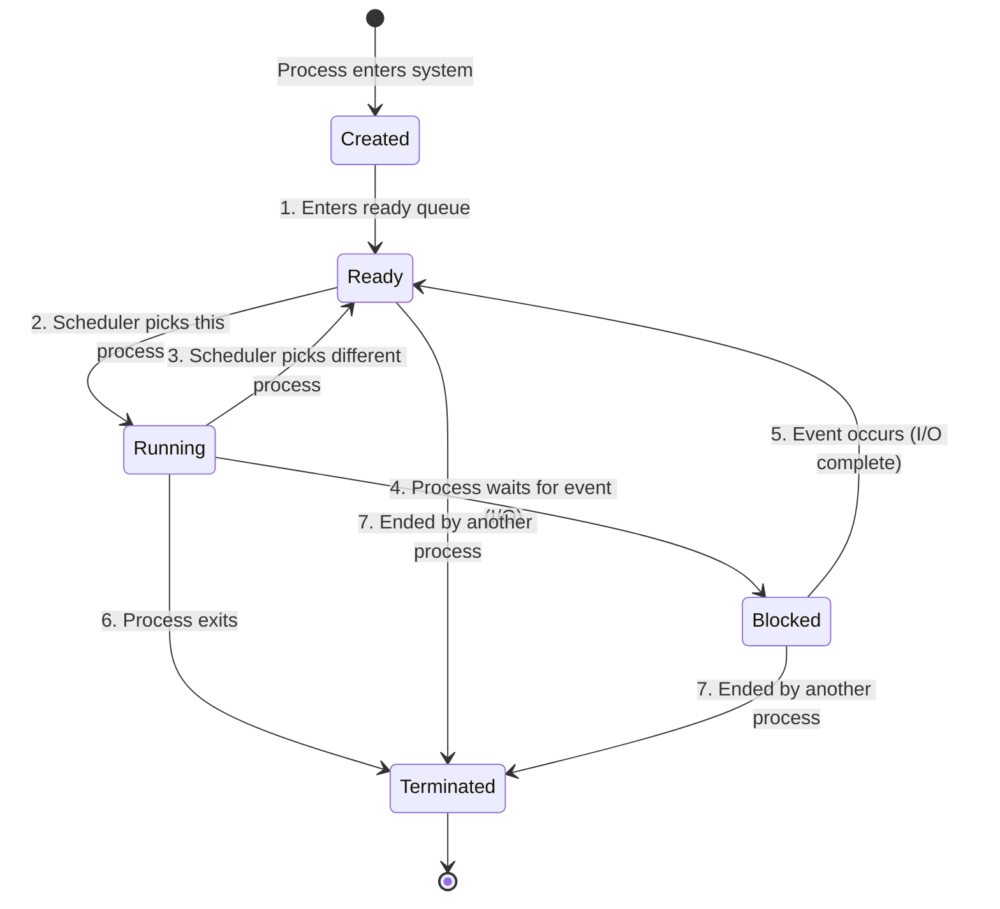
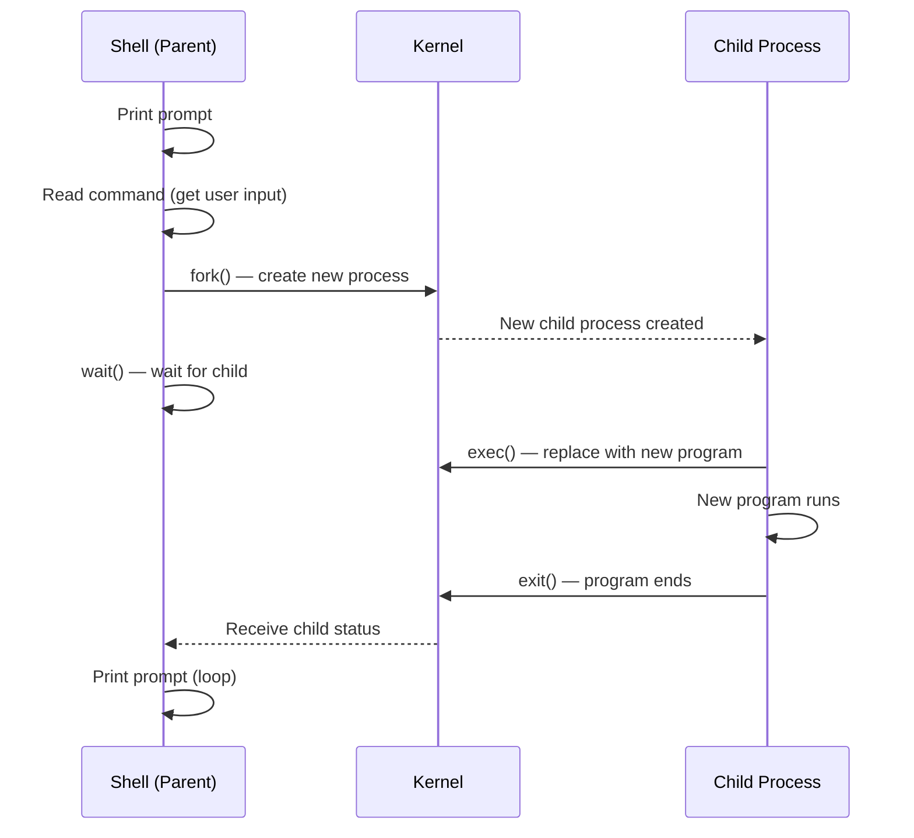

# Lecture 2 — Process: Concept and API

> **Course**: COS40003 Concurrent Programming
> **Topic**: Processes — What, Why, How, and APIs

---

## Outline
1. [[#What is a Process?]]
2. [[#Why Do We Need Processes?]]
3. [[#How a Process Works]]
4. [[#Process APIs]]

---

## What is a Process?

### Program vs Process

| | Program | Process |
|---|---|---|
| **Nature** | **Static** — code (a set of instructions) stored in a file | **Dynamic** — a program in action (currently executing) |
| **Definition (narrow)** | Binary machine code, a sequence of machine-language instructions stored in a file | Current program and its activity |
| **Analogy** | A recipe written on paper | Actually cooking the recipe |

### Running a Program (simplified)
1. Load machine-language instructions into **memory**
2. Read instructions into **CPU**
3. CPU executes instructions **one by one**

> [!NOTE]
> This is a simplified abstraction — it ignores cache and multi-instruction optimization.

### Key Distinction
- **Program** = code (static, on disk)
- **Process** = a program **in action** (dynamic, in memory)

---

## Why Do We Need Processes?

### Historical Evolution of Computing

#### Period 1 — Single Command
- Computer is very simple
- User types a command → computer executes → both stop
- **Problem**: ⚠️ Low efficiency

#### Period 2 — Batch Processing
- Write commands as a list (a **program**), let the computer run through them
- Multiple programs run **in turn**
- **Problem**: When Program A does **I/O** (read/write data), the **CPU sits idle** waiting
- **Insight**: Can we let Program B use the CPU while Program A is doing I/O?

##### New Challenges
- Memory previously held **one program only** → now we want **multiple programs**
- Questions arise:
  - How to **identify** different programs, code/data segments?
  - How to **restore** a program after suspension?

#### Period 3 — Process is Invented! 🎉
- A program is **encapsulated** in a process
- Every process is allocated a **chunk of memory** and can only use **its own memory**
- Process **state and resources** can be saved
- When switched back → easily **restore** previous state and continue
- Different processes **will not affect each other** (isolation)

---

## How a Process Works

### Process Components

A process consists of:

1. **Image of a program** (code)
2. **Memory**:
   - Program instructions
   - Static data
   - Heap (dynamic allocation)
   - Stack (function/system calls)
3. **CPU state**:
   - Registers
   - Program Counter (PC)
   - Stack Pointer (SP)
4. **Operating system state**:
   - Opened files
   - Accounting statistics, etc.

### Process Address Space

Each process runs in its own **virtual memory address space**:

```
┌─────────────────┐  High Address
│      Stack      │  ← function & system calls (grows ↓)
│        ↓        │
│                 │
│        ↑        │
│      Heap       │  ← dynamic allocation (grows ↑)
├─────────────────┤
│   Static Data   │  ← global/static variables
├─────────────────┤
│  Program (Code) │  ← instructions (usually read-only)
└─────────────────┘  Low Address
```

> [!IMPORTANT]
> Invoking the **same program multiple times** results in the creation of **multiple distinct address spaces** — each process has its own isolated memory.

### Stack vs Heap Memory

| Stack | Heap |
|---|---|
| Used for function calls and local variables | Used for dynamically allocated memory |
| Managed automatically (LIFO) | Managed manually (or by GC) |
| Fast access | Slower access |
| Fixed size | Flexible size |

---

### Context Switch

A **context switch** is how the OS switches the CPU from one process to another.

#### Phase 1 — CPU is running Prog1
- Prog1 has CPU, Prog2 is suspended

#### Phase 2 — Save state of Prog1
- OS **saves** registers, program counter (PC), and stack pointer (SP) of Prog1
- Prog1 is suspended

#### Phase 3 — Restore state of Prog2
- OS **restores** registers, PC, and SP of Prog2

#### Phase 4 — CPU runs Prog2
- Prog2 has CPU, Prog1 is suspended



---

### The Process Abstraction

- **Physical view**: One CPU shared among processes
- **Logical view**: Each process thinks it has its own CPU
- **Time-sharing**: Processes take turns using the CPU rapidly, creating the illusion of simultaneous execution

---

### Process States



| State | Description |
|---|---|
| **Created (Initial)** | Process is being created |
| **Ready** | Process is ready to run, but OS has chosen not to run it yet (e.g., another process is running) |
| **Running** | Process is actively executing instructions on the CPU |
| **Blocked (Waiting)** | Process is waiting for some event (e.g., I/O completion) before it can continue |
| **Terminated (Final/Zombie)** | Process has exited but not yet been cleaned up — allows parent to examine the return code |

### State Transition Examples

#### Example 1: CPU Only
- Process0 runs first, Process1 is ready
- After Process0 finishes → Process1 starts running

#### Example 2: CPU and I/O
- Process0 runs → issues I/O → becomes **Blocked**
- Process1 gets a chance to **Run**
- When I/O completes → Process0 moves back to **Ready**

---

### Scheduling (Preview for Week 3)

To realize **time-sharing**, the OS uses:
1. **Context switch** — mechanism to save/restore process state
2. **Scheduling policy** — decides which process runs next, based on:
   - Historical information (e.g., which program ran more recently)
   - Workload knowledge (e.g., types of programs running)
   - Performance metrics (e.g., optimize for interactive performance or throughput)

---

## Process APIs

The three fundamental process APIs in Unix:

### `fork()` — Create a New Process

Creates a new process by **duplication (cloning)** the current process.

#### How `fork()` works:
1. Allocates a new chunk of **memory** and kernel data structures
2. **Copies** the original process into the new process
3. Adds the new process to the set of **running processes**
4. Returns control to **both** processes (parent and child)

#### Distinguishing Parent from Child:
```c
int pid;
pid = fork();
if (pid == 0)
    // We are in the CHILD process
else
    // We are in the PARENT process (pid = child's PID)
```

> [!TIP]
> `fork()` returns **0** to the child, and the **child's PID** to the parent.

---

### `wait()` — Wait for Child to Exit

Pauses the calling (parent) process until a child finishes.

```c
pid = wait(&status);
```

| Return | Meaning |
|---|---|
| `pid` | PID of the terminated child process |
| `-1` | Error occurred |
| `status` | Exit status: Success, Failure (e.g., out of memory), or Death (killed by signal) |

---

### `exec()` — Run a Different Program

Replaces the current process's code and data with a **new program**.

#### How `exec()` works:
1. Clears out the machine-language code of the current program
2. Loads the code of the **new program** specified in the exec call
3. Adjusts memory allocation to fit the new program's requirements
4. Runs the new program

> [!NOTE]
> The **process is the same** (same PID), but the **contents are new**.
> Analogy: **Brain Transplant** 🧠 — same body, different mind.

#### Variants: `execl`, `execle`, `execlp`, `execv`, `execvp`, `execvP`

---

### How the Shell Runs a Program



**Flow**: `print prompt` → `read command` → `fork()` → parent calls `wait()` / child calls `exec()` → child runs & exits → parent resumes

---

## Exercise

**How many lines of output will this program produce?**

```c
main() {
    printf("my pid is %d\n", getpid());
    fork();
    fork();
    fork();
    printf("my pid is %d\n", getpid());
}
```

> [!TIP] Answer
> - First `printf`: **1 line** (only the original process)
> - After 3 `fork()` calls: $2^3 = 8$ processes
> - Second `printf`: **8 lines** (one per process)
> - **Total: 9 lines**

---

## Key Concepts Summary

| Concept | Description |
|---|---|
| **Process** | A program in action; encapsulates code, data, and state |
| **Address Space** | Virtual memory with stack, heap, static data, and code segments |
| **Context Switch** | Saving one process's state and restoring another's |
| **Process States** | Created → Ready → Running → Blocked → Terminated |
| **fork()** | Clone current process; returns 0 to child, child PID to parent |
| **wait()** | Parent blocks until child exits |
| **exec()** | Replace current process's program with a new one |

---

## References
- *Operating Systems: Three Easy Pieces* — Chapters 4–5
- Intro to Operating Systems — Portland State University (Jonathan Walpole)

---

#concurrent-programming #processes #fork #context-switch #week2
