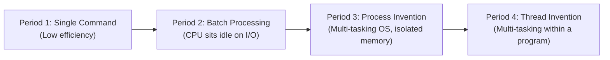
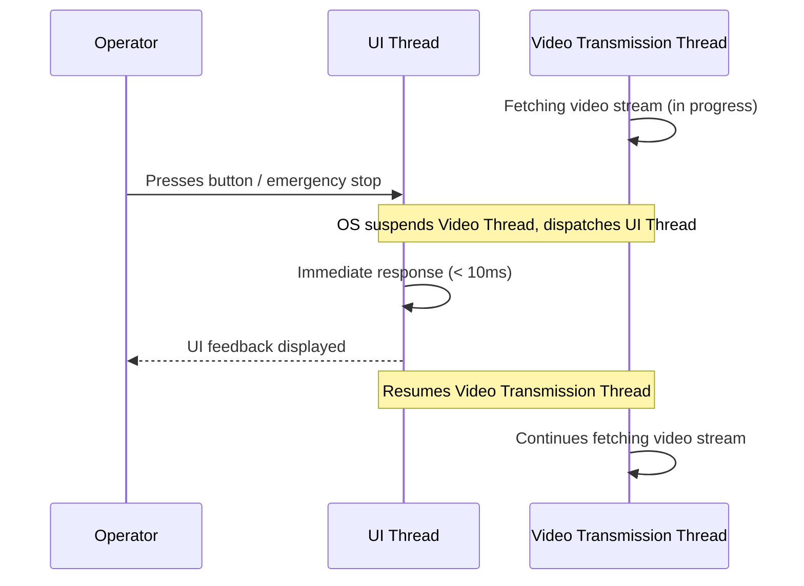
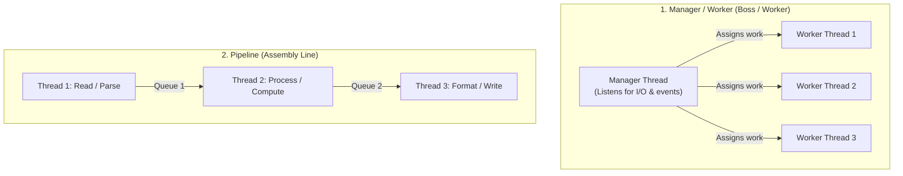
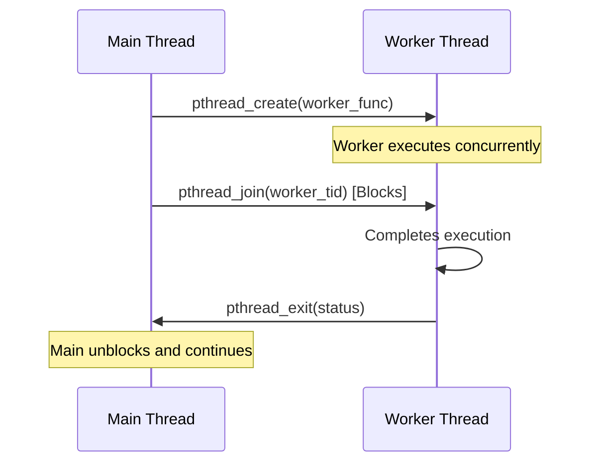
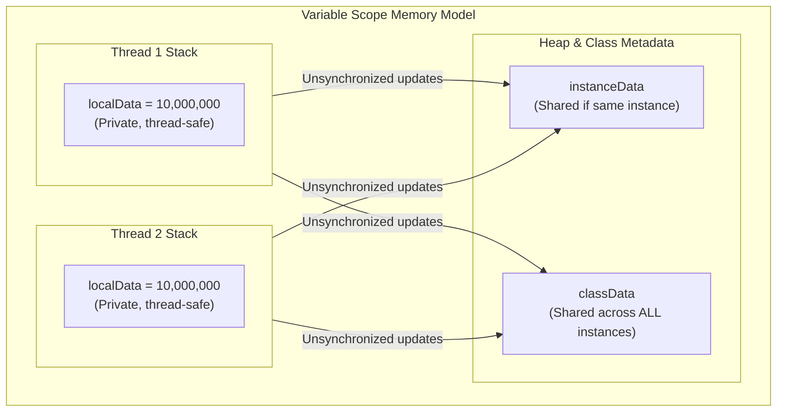

# Lecture 4 — Thread

> **Course**: COS40003 Concurrent Programming
> **Topic**: Threads — Concept, Multi-threading Models, and Java Thread Programming

---

## Outline
1. [Why we need threads?](#why-we-need-threads)
2. [What is a thread?](#what-is-a-thread)
3. [How threads are working?](#how-threads-are-working)
4. [Thread in Java](#thread-in-java)

---

## Why we need threads?

> Overcome the limitations of single-threaded processes to achieve real-time responsiveness, overlap I/O with computation, and avoid high IPC overhead.

### Historical Context: From Commands to Threads

The abstraction of concurrent execution evolved through four distinct historical periods:

- **Period 1 — Single Command**: The computer executed one command from the user and stopped. CPU utilization and efficiency were extremely low.
- **Period 2 — Batch Processing**: Programs were written as lists of commands executed sequentially. When a program performed I/O, the CPU sat idle waiting for data transfer to finish.
- **Period 3 — Process Invention**: Programs were encapsulated into isolated processes. Each process received its own dedicated chunk of memory and CPU state. Through time-sharing, the operating system simulated multitasking across different programs.
- **Period 4 — Thread Invention**: As interactive and multimedia applications arose, a single program needed to execute multiple concurrent activities simultaneously without freezing.



---

### Motivating Scenario: An Interactive Monitoring System

Consider a single-program monitoring application that performs three core functions:
1. **Function 1**: Retrieve video data from a recording device (e.g., takes 5 seconds per retrieval).
2. **Function 2**: Render and display data on the operator's screen.
3. **Function 3**: Interact with the operator (e.g., respond to button clicks, alerts).

#### The Problem with Single-Threaded Execution
In a single-threaded program, if the operator presses a button while Function 1 is executing, the program cannot respond until the 5-second video retrieval finishes. For interactive or mission-critical systems, this delay is completely unacceptable.

#### The Solution: Subtask Decomposition
By separating functions into concurrent subtasks (threads) within the same process:
- A background **video-transmission thread** retrieves recording data.
- A **UI thread** handles operator interaction immediately.
- When the button is pressed, the OS pauses video transmission, immediately processes the operator's input, and resumes video transmission.
- All threads operate efficiently inside the **same working space**.



---

### Why Not Use Separate Processes?

Why not simply create a separate *process* for each subtask?

Processes have isolated address spaces, which introduces major bottlenecks:
- **Data Cost**:
  - **Data Redundancy**: Passing large data buffers (such as video streams) between processes requires creating duplicate copies in memory.
  - **Data Consistency**: Synchronizing changes across independent memory spaces requires complex cross-process mechanisms.
- **Communication Cost**:
  - Inter-Process Communication (IPC) via pipes, sockets, or shared memory system calls is computationally expensive and introduces substantial kernel overhead compared to direct in-memory variable access.

---

### Application Examples

1. **Word Processor Program**:
   - Uses three concurrent threads running inside the same process:
     - **Thread 1 (UI)**: Listens for keystrokes, handles formatting, and renders text to screen.
     - **Thread 2 (Spellchecker)**: Continuously evaluates text in the background for grammar and spelling errors without stuttering user typing.
     - **Thread 3 (Disk I/O)**: Periodically autosaves the document to disk in the background to prevent data loss.

2. **Web Server**:
   - A dispatcher thread listens on port 80 for incoming HTTP requests (`GET /index.html`).
   - Multiple worker threads process requests concurrently, reading web pages from a shared in-memory cache and streaming responses to clients without blocking other requests.

3. **High-Concurrency Challenges (e.g., Australian Census 2016)**:
   - When millions of citizens accessed the online census servers concurrently, servers were overwhelmed by connection and request surges. This highlights the vital need for disciplined thread allocation, concurrency control, and request-queue management.

---

## What is a thread?

> An abstraction for a stream of instructions and an execution context (PC, SP, registers, private stack) operating within a shared process address space.

### Basic Definition

| Abstraction | Informal Definition | Formal Systems Definition |
|---|---|---|
| **Process** | A running program / program in action | An address space + OS resources + CPU context |
| **Thread** | A running subtask of a program | A stream of instructions + CPU context + private stack within a process |

- **Traditional Process**: A memory address space containing a **single thread of control**.
- **Multithreaded Process**: A single memory address space containing **multiple threads of control** running concurrently.

---

### Memory & State Architecture

A thread executes within the address space of its hosting process. The operating system divides state into **private per-thread state** and **shared process-level state**:

```
┌──────────────────────────────────────────────────────────────┐
│                    Process Address Space                     │
│                                                              │
│  ┌─────────────────────────┐    ┌─────────────────────────┐  │
│  │   Program Code (Text)   │    │ Static / Global Data    │  │
│  └─────────────────────────┘    └─────────────────────────┘  │
│  ┌────────────────────────────────────────────────────────┐  │
│  │                    Shared Heap Memory                  │  │
│  └────────────────────────────────────────────────────────┘  │
│                                                              │
│   Thread 1              Thread 2              Thread 3       │
│  ┌───────────────┐     ┌───────────────┐     ┌─────────────┐ │
│  │ Private Stack │     │ Private Stack │     │Private Stack│ │
│  │ (local vars)  │     │ (local vars)  │     │(local vars) │ │
│  └───────────────┘     └───────────────┘     └─────────────┘ │
└──────────────────────────────────────────────────────────────┘
          │                     │                     │
          ▼                     ▼                     ▼
     CPU Context 1         CPU Context 2         CPU Context 3
   (PC, SP, Regs)        (PC, SP, Regs)        (PC, SP, Regs)
```

#### 1. Private Per-Thread State
The elements required to maintain an individual thread's execution flow:
- **Program Counter (PC)**: Tracks the address of the next machine instruction for this thread.
- **Stack Pointer (SP)**: Points to the current top of the thread's execution stack.
- **CPU Registers**: Working registers, arithmetic flags, and state variables.
- **Private Stack**: Allocated for each thread to store local variables, function arguments, and return addresses.
- **Scheduling Attributes**: Thread priority, state (Ready, Running, Blocked), and thread identifier.

#### 2. Shared State Among Threads (Process-Level)
The resources and memory shared by all threads residing in the same process:
- **Address Space**:
  - Program Instructions (Code segment).
  - Static & Global Data.
  - Heap Memory (dynamically allocated memory).
- **Operating System Resources**:
  - User ID, Group ID, Process ID (PID).
  - Open file descriptors, network sockets.
  - Synchronization primitives (locks, condition variables, semaphores).

---

### Comparison: Processes vs. Threads

| Dimension | Process | Thread |
|---|---|---|
| **Role in OS** | Basic unit of **resource allocation** | Basic unit of **CPU scheduling & execution** |
| **Multitasking Level** | Makes the **operating system** multitasking | Makes an individual **process** multitasking |
| **Address Space** | Isolated virtual address space per process | Threads of a process share the same address space |
| **Resource Sharing** | Do not share resources directly (requires IPC) | Freely share memory, file descriptors, and sockets |
| **Creation Overhead** | High (allocates page tables, process descriptors) | Low (allocates execution stack and thread control block) |
| **Context Switch Overhead** | High (flushes TLB, swaps page directories) | Low (only saves/restores registers, PC, and SP) |
| **Fault Isolation** | Isolated (one process crash does not crash others) | Not isolated (one crashed thread terminates entire process) |

---

### Why Use Threads? (Summary of Benefits)

1. **Overlap computation and blocking on a single CPU**: While one thread blocks on disk or network I/O, other threads continue computing.
2. **Utilize multiple CPUs concurrently**: Multiple threads run on separate CPU cores simultaneously for true hardware parallelism.
3. **Low-cost communication**: Communication occurs through shared memory without operating system context switches or system call overhead.

---

## How threads are working?

> Programs decompose work into routines using strategies such as Manager/Worker and Pipeline, coordinated via thread management APIs.

### Multithreaded Programming Strategies

To execute multiple routines concurrently, developers structure multithreaded systems using standard architectural patterns:



1. **Manager / Worker Strategy**:
   - A single **manager thread** handles I/O, user input, or network sockets.
   - The manager dispatches tasks to **worker threads**.
   - Worker threads can be created dynamically or retrieved from a pre-allocated thread pool.
2. **Pipeline Strategy**:
   - Structured like a physical assembly line.
   - Each thread performs a specific subtask or transformation on data and passes the intermediate result to the next thread using a producer-consumer queue.
3. **Peer Strategy**:
   - All threads execute identical logic on distinct segments of data (data parallelism), such as concurrent image filtering or matrix calculations.

---

### POSIX Threads API (Pthreads in C)

The standard IEEE POSIX thread interface in C (`pthread.h`) defines fundamental primitives for managing thread lifecycles:

| Pthreads Function | Signature & Behavior                                                                                                                           |
| ----------------- | ---------------------------------------------------------------------------------------------------------------------------------------------- |
| `pthread_create`  | `pthread_create(&thread, &attr, start_routine, arg)`<br>Spawns a new thread executing `start_routine(arg)`. Returns the thread ID in `thread`. |
| `pthread_exit`    | `pthread_exit(status)`<br>Terminates the calling thread and returns an exit status to any joining thread.                                      |
| `pthread_join`    | `pthread_join(threadid, &status)`<br>Blocks the calling thread until thread `threadid` terminates; retrieves the thread's exit `status`.       |
| `pthread_yield`   | `pthread_yield()`<br>Voluntarily releases the CPU, placing the calling thread back into the OS ready queue.                                    |



---

### Pros and Cons of Multithreading

#### Pros (Advantages)
- **Overlap I/O with Computation**: Keeps the CPU saturated while waiting for slow peripheral operations.
- **Cheaper Context Switches**: Significantly faster than full process context switches because memory mappings stay unchanged.
- **Better Mapping to Multiprocessors**: Directly exploits modern multi-core and multi-processor hardware.
- **Fast Inter-Thread Communication**: Direct pointer/variable reads and writes in shared memory.

#### Cons (Disadvantages)
- **Potential Thread Interactions**: Uncontrolled access to shared mutable data introduces **race conditions**, **deadlocks**, and **data corruption**.
- **Debugging Complexity**: Interleaved execution produces non-deterministic, timing-dependent bugs (Heisenbugs) that are hard to reproduce.
- **Programming Complexity**: Requires explicit concurrency management, lock acquisition discipline, and thread coordination.
- **Backward Compatibility**: Legacy non-reentrant libraries cannot be safely invoked from concurrent threads.

---

## Thread in Java

> Java provides built-in multithreading primitives via the Thread class, the Runnable interface, and the java.util.concurrent framework.

### Thread Creation in Java

Java provides built-in multithreading primitives via `java.lang.Thread` and `java.lang.Runnable`.

#### Option 1: Extending the `Thread` Class
Override the `run()` method in a derived class:

```java
public class Thread1 extends Thread {
    @Override
    public void run() {
        System.out.println("Thread ID: " + Thread.currentThread().getId() + " initiated");
        PrintNumbers.printNumbers();
    }

    public static void main(String[] args) {
        System.out.println("Main Thread ID: " + Thread.currentThread().getId());
        for (int i = 0; i < 3; i++) {
            new Thread1().start(); // DO NOT CALL run() directly!
        }
    }
}
```

#### Option 2: Implementing the `Runnable` Interface
Implement the abstract `run()` method from `Runnable` and pass the instance to a `Thread` constructor:

```java
public class Thread2 implements Runnable {
    @Override
    public void run() {
        System.out.println("Thread ID: " + Thread.currentThread().getId() + " initiated");
        PrintNumbers.printNumbers();
    }

    public static void main(String[] args) {
        System.out.println("Main Thread ID: " + Thread.currentThread().getId());
        for (int i = 0; i < 3; i++) {
            new Thread(new Thread2()).start(); // DO NOT CALL run() directly!
        }
    }
}
```

#### Advantage of Implementing `Runnable`
- **Single Inheritance Rule**: Java allows a class to extend only **one** superclass. Extending `Thread` consumes that single inheritance slot. Implementing `Runnable` keeps the class free to extend domain-specific base classes.
- **Separation of Concerns**: Decouples the work to be done (`Runnable` task) from the execution engine (`Thread`).
- **Thread Pool Integration**: `Runnable` instances can be executed directly by thread pools and executors.

> [!IMPORTANT] Always Call `.start()`, Never `.run()`
> - Calling `.start()` creates an OS execution thread and schedules `run()` to execute asynchronously.
> - Calling `.run()` directly executes `run()` as a ordinary method **synchronously on the caller thread** — no new thread is created!

---

### Core Java Thread Methods

- `start()`: Prepares the thread and makes it eligible for CPU scheduling.
- `join()`: Blocks the calling thread until the target thread finishes execution.
- `setPriority(int priority)`: Configures thread priority from `Thread.MIN_PRIORITY` (1) to `Thread.MAX_PRIORITY` (10); default is `Thread.NORM_PRIORITY` (5).
- `Thread.sleep(millis)`: Pauses execution for a specified duration without relinquishing acquired locks.
- `wait()` and `notify()` / `notifyAll()`: Object-level monitor methods used for thread coordination and conditional waiting.
- **Deprecated Methods**: `stop()`, `suspend()`, and `resume()` are deprecated and unsafe because they can freeze locks permanently, causing deadlock and memory inconsistencies.

---

### Thread Safety in the Java Standard Library

Not all Java classes are thread-safe:

- **Thread-Safe**:
  - Most classes in `java.lang` (e.g., immutable types like `String`, `Integer`).
  - `java.util.Random` (designed for safe concurrent number generation).
  - `System.out` (internal synchronization prevents garbled output streams).
- **NOT Thread-Safe**:
  - Most standard collections in `java.util` (`ArrayList`, `HashMap`, `LinkedList`, `HashSet`). Multiple threads modifying an `ArrayList` simultaneously can corrupt its internal arrays or throw `ConcurrentModificationException`.
  - Java GUI frameworks (`javax.swing`, `java.awt`). Modifying GUI components from background threads leads to invalid visual state; updates must occur exclusively on the **Event Dispatch Thread (EDT)**.

---

### Shared Variables, Memory Scopes, and Atomicity

#### The Concept of Atomicity
> An operation is **atomic** if it executes as a single, indivisible step without interruption.

In Java, integer increment (`count++`) is **NOT atomic**. It consists of three separate machine operations:
1. **Read**: Fetch the variable from memory into a CPU register.
2. **Modify**: Increment the value inside the register.
3. **Write**: Store the updated value back to memory.

When two threads execute `count++` concurrently, their read-modify-write cycles interleave, leading to **lost updates**:

```
Thread 1 (reads count = 5)
                           Thread 2 (reads count = 5)
Thread 1 (increments to 6)
                           Thread 2 (increments to 6)
Thread 1 (writes count = 6)
                           Thread 2 (writes count = 6)  <-- Race condition: expected 7, got 6!
```

---

#### Variable Memory Scopes (`IncrementTest` Analysis)

```java
public class IncrementTest implements Runnable {
    static int classData = 0;   // Static (Class-level)
    int instanceData = 0;       // Instance (Heap-level)

    public void run() {
        int localData = 0;      // Local (Stack-level)
        while (localData < 10000000) {
            localData++;
            instanceData++;
            classData++;
        }
        System.out.println("localData: " + localData +
                           "\tinstanceData: " + instanceData +
                           "\tclassData: " + classData);
    }
}
```



1. **`localData = 10,000,000`**: Stored on each thread's private call stack. Each thread has its own independent copy; no race condition can occur.
2. **`instanceData != 20,000,000`**: Stored in the heap object.
   - When both threads share one `IncrementTest` instance, concurrent unsynchronized increments cause race conditions and lost updates.
   - If thread 2 runs on a separate instance (`new IncrementTest()`), each thread has a distinct `instanceData`, correctly reaching `10,000,000` on each object.
3. **`classData != 20,000,000`**: Stored in static class memory. It is shared across **all instances and threads** in the JVM, always producing a race condition regardless of how instances are allocated.

---

### Thread Pools & Executor Framework

#### Why Use Thread Pools?
Creating a fresh thread for every incoming task or client request is inefficient:
1. **OS Resource Overhead**: Creating a thread consumes CPU cycles and memory (allocating stack space, setting up kernel control blocks).
2. **High-Frequency Waste**: When individual requests are short-lived, the server spends more time and system resources creating and destroying threads than executing actual client work.
3. **System Crashes under Load**: If an unbounded number of requests arrive simultaneously, spawning unlimited threads leads to severe context-switch thrashing or fatal `OutOfMemoryError`.

---

#### How Thread Pools Work

A thread pool creates a fixed group of worker threads at startup and maintains a **Task Queue**:

```mermaid
sequenceDiagram
    participant Submitter as Client / Main Thread
    participant Queue as Task Queue
    participant Worker as Worker Thread Pool

    Note over Worker: Worker threads wait() when Queue is empty
    Submitter->>Queue: Submit Task (execute)
    Queue-->>Worker: notify() wakes an idle worker
    Worker->>Queue: Pull task from queue
    Worker->>Worker: Execute task.run()
    Worker->>Queue: Task finished; worker returns to pull next task (or wait)
```

1. **Worker Threads Sleep**: When the queue is empty, worker threads invoke `wait()` and sleep.
2. **Task Insertion**: When a new `Runnable` task is placed into the queue, `notify()` is called to wake an idle worker thread.
3. **Task Execution**: The awakened worker retrieves the task and runs its `run()` method.
4. **Worker Reuse**: Upon task completion, the thread does **not** terminate; it returns to the queue to process pending tasks or wait for new work.

---

#### Thread Pool API in Java (`ExecutorService`)

Java provides thread pools via the `java.util.concurrent` package:

```java
import java.util.concurrent.ExecutorService;
import java.util.concurrent.Executors;
import java.util.concurrent.TimeUnit;

public class ThreadPoolExample {
    public static void main(String[] args) throws InterruptedException {
        // Create a fixed pool with 3 reusable worker threads
        ExecutorService executor = Executors.newFixedThreadPool(3);

        // Submit tasks to the executor
        executor.execute(new Task1());
        executor.execute(new Task2());
        executor.execute(new Task3());

        // Orderly shutdown: stops accepting new tasks, allows active tasks to finish
        executor.shutdown();

        // Wait for all submitted tasks to complete
        executor.awaitTermination(1, TimeUnit.MINUTES);
    }
}
```

- `Executors.newFixedThreadPool(n)`: Allocates an `ExecutorService` with a fixed pool of `n` worker threads.
- `execute(Runnable task)`: Queues the task for asynchronous execution by an available worker thread.
- `shutdown()`: Initiates an orderly shutdown: stops accepting new tasks while draining queued tasks.
- `awaitTermination(timeout, unit)`: Blocks until all tasks complete or the timeout expires.

---

#### Pool Sizing and Handling Request Overload

- **Pool Sizing Trade-offs**:
  - **Too Large**: High memory consumption, excessive context-switch overhead, and potential starvation from resource exhaustion.
  - **Too Small**: CPU underutilization, long waiting times in the task queue, and delayed response latency.

- **Rule of Thumb Formulas**:
  - For CPU-bound tasks:
    $$\text{Pool Size} \approx N_{\text{CPUs}} + 1$$
  - For I/O-bound tasks:
    $$\text{Pool Size} \approx N_{\text{CPUs}} \times \left(1 + \frac{\text{Wait Time}}{\text{Compute Time}}\right)$$

- **Handling Server Overload**:
  - **Limit Task Queue Size**: Do not permit queues to grow unboundedly, preventing memory exhaustion under traffic spikes.
  - **Reject Excess Requests**: Return error codes (e.g., HTTP 503 Service Unavailable / 429 Too Many Requests) or drop tasks gracefully when capacity is exceeded.
  - **Dynamic Pool Sizing**: Adjust pool limits according to workload characteristics, avoiding frequent re-allocations.

---

## References
- *Operating Systems: Three Easy Pieces* — Chapter 26: Concurrency: An Introduction (Remzi H. Arpaci-Dusseau and Andrea C. Arpaci-Dusseau)
- Intro to Operating Systems — Portland State University (Jonathan Walpole)
- Oracle Java Tutorials — Concurrency & Essential Classes: [Java Concurrency Tutorial](https://docs.oracle.com/javase/tutorial/essential/concurrency/)

---

#concurrent-programming #threads #multithreading #pthreads #java-threads #thread-pools #race-conditions #week4
