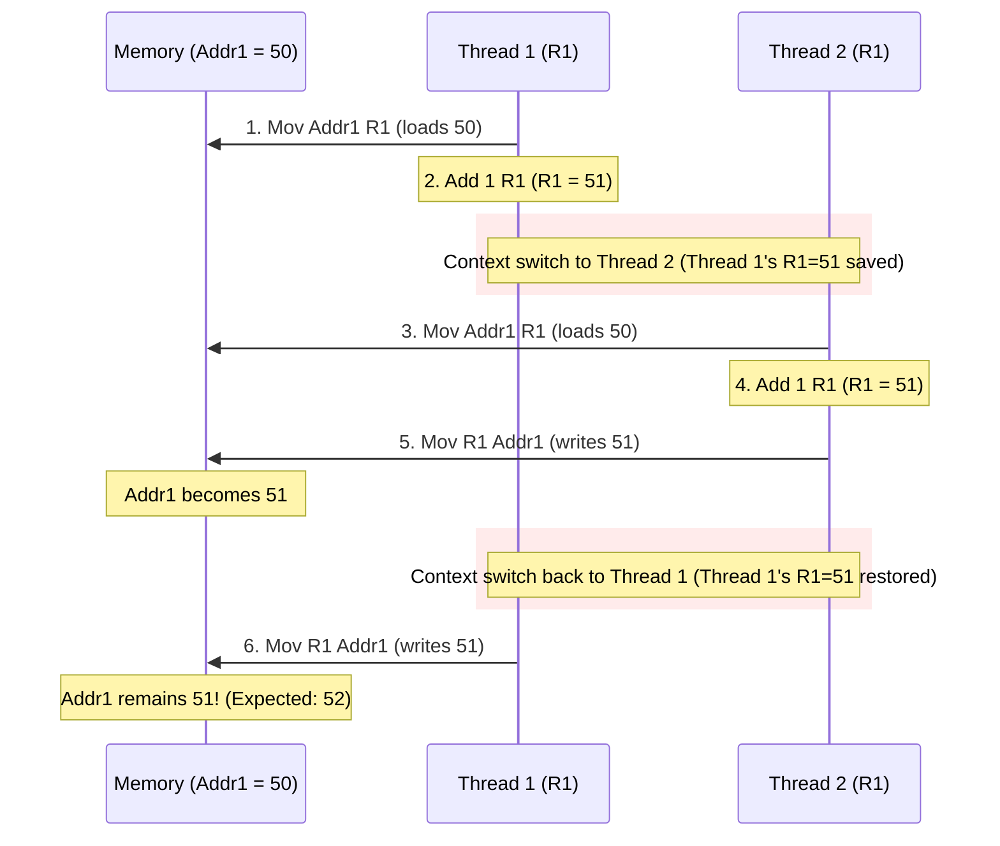
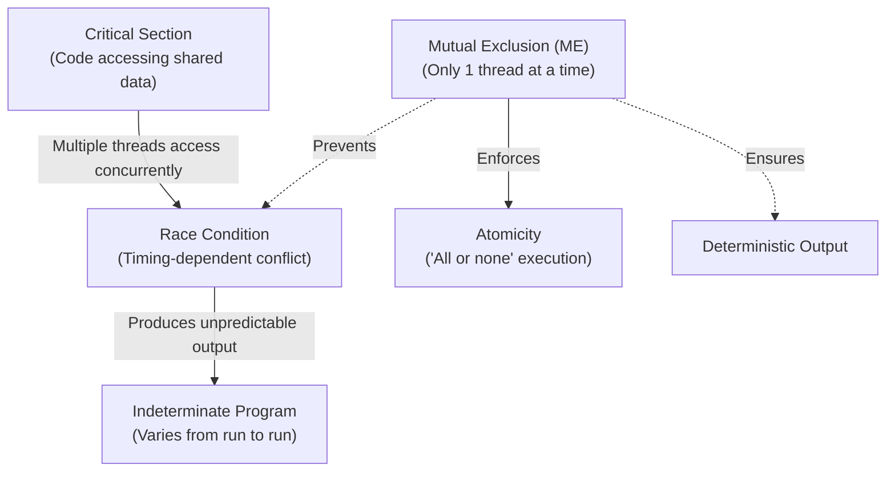

# Lecture 5 — Lock (I)

> **Course**: COS40003 Concurrent Programming  
> **Topic**: Lock (I) — Concurrency Problems, Terminology, and Lock Implementations  

---

## Outline
1. [Why there is concurrency problem?](#why-there-is-concurrency-problem)
2. [Key concurrency terms](#key-concurrency-terms)
3. [Lock implementation](#lock-implementation)
   - [Using Lock object](#using-lock-object)
   - [Using Synchronized keyword](#using-synchronized-keyword)

---

## Why there is concurrency problem?

> Unsynchronized concurrent access to shared mutable data interleaves non-atomic read-modify-write operations, leading to race conditions and lost updates.

### Review: Process vs. Thread Context Switch

Before analyzing concurrency problems, recall the fundamental difference in context-switch overhead between processes and threads:

#### Question: Why is a process context switch more expensive than a thread context switch?

- **Process switch**: Switches **CPU state** AND **memory working space** (swaps page directories, flushes TLB, invalidates caches).
- **Thread switch**: Switches **CPU state** only (registers, PC, SP); the **memory working space** (code, static data, heap) is shared and untouched.

| | Process Context Switch | Thread Context Switch |
|---|---|---|
| **What is switched?** | **CPU state** AND **Memory working space** | **CPU state** only |
| **State Details** | Registers, PC, SP, Page Tables, Address Space | Registers, Program Counter (PC), Stack Pointer (SP) |
| **Address Space** | Swapped out (new virtual memory mapping) | Shared (remains in the same address space) |
| **Hardware Cache / TLB** | TLB must be flushed; CPU cache becomes cold | TLB and cache entries remain valid |
| **Overhead** | Heavyweight (expensive) | Lightweight (fast) |


---

### Example 3 (Recall): Shared Variables in Concurrency

Recall the `IncrementTest` program from Week 4:

```java
public class IncrementTest implements Runnable {
    static int classData = 0;   // Static (Class-level)
    int instanceData = 0;       // Instance (Heap-level)

    @Override
    public void run() {
        int localData = 0;      // Local (Stack-level)
        while (localData < 10000000) {
            localData++;
            instanceData++;
            classData++;
        }
        System.out.println("localData: " + localData +
                           "\tinstanceData: " + instanceData +
                           "\tclassData: " + classData);
    }
}
```

#### Memory Scopes Comparison

| Variable | Scope / Storage | Shared? | Concurrent Access Result |
|---|---|---|---|
| `localData` | Thread Call Stack | **Not shared** — used strictly within the calling function | Safe! Each thread reaches `10,000,000` |
| `instanceData` | Heap Object | **Shared between threads accessing the same object** | Race condition if threads share instance (`!= 20,000,000`) |
| `classData` | Method Area / Static | **Shared between ALL instances and threads of the class** | Race condition across entire JVM (`!= 20,000,000`) |

#### Results When Running Two Threads:
```
Results:
  localData = 10,000,000        ✓ (Correct — thread-private)
  instanceData != 20,000,000    ⚠️ (Corrupted — shared heap)
  classData != 20,000,000       ⚠️ (Corrupted — shared static)
```

> [!NOTE] Instance Separation Experiment
> If we create Thread 2 with another instance:
> ```java
> IncrementTest instance2 = new IncrementTest();
> Thread t2 = new Thread(instance2);
> ```
> - Each object has its own copy of `instanceData` $\rightarrow$ both threads report `instanceData = 10,000,000` correctly.
> - However, `classData` is static and shared between all instances $\rightarrow$ `classData != 20,000,000` still suffers from race conditions!

---

### Assembly Level Decomposition: Why `i++` Is Not Atomic

In high-level languages, `i++` looks like an atomic, single-step operation. At the machine level, it is decomposed into **three separate assembly instructions** (a read-modify-write cycle):

```
1. Mov Addr1 R1    ; [READ]   Load value from memory address Addr1 into CPU register R1
2. Add 1 R1        ; [MODIFY] Increase value in Register R1 by 1
3. Mov R1 Addr1    ; [WRITE]  Store value from Register R1 back to memory Addr1
```

- `Addr1`: Variable location in memory (RAM).
- `R1`: Working register inside the CPU.

---

### Step-by-Step Race Condition Walkthrough

Suppose the variable at `Addr1` initially holds the value **50**. Two threads attempt to execute `i++`:

```
Beginning value at Addr1 is 50
```

| Step | Thread | Instruction Executed | R1 Value | Addr1 (Memory) | Context Action |
|:---:|:---|:---|:---:|:---:|:---|
| 1 | **Thread 1** | `Mov Addr1 R1` | 50 | 50 | Loads 50 into R1 |
| 2 | **Thread 1** | `Add 1 R1` | 51 | 50 | Increments R1 to 51 |
| — | — | *(Context Switch)* | — | 50 | **OS suspends Thread 1; Thread 1's R1 (51) is saved** |
| 3 | **Thread 2** | `Mov Addr1 R1` | 50 | 50 | Loads 50 into R1 |
| 4 | **Thread 2** | `Add 1 R1` | 51 | 50 | Increments R1 to 51 |
| 5 | **Thread 2** | `Mov R1 Addr1` | 51 | **51** | Writes 51 to memory |
| — | — | *(Context Switch)* | — | 51 | **OS switches back to Thread 1; Thread 1's R1 (51) is restored** |
| 6 | **Thread 1** | `Mov R1 Addr1` | 51 | **51** | Overwrites memory with 51! |



> [!WARNING] The Lost Update
> Even though two increments were executed, the final value in memory is **51** instead of **52**. Thread 2's update was completely overwritten and lost because the read-modify-write operation was interleaved non-atomically!

---

## Key concurrency terms

> Foundational concepts establishing the principles of concurrent synchronization and correctness.



### 1. Critical Section
> A **critical section** is a piece of code that accesses a **shared resource**, usually a variable or data structure.

- Inside `IncrementTest`, the block:
  ```java
  instanceData++;
  classData++;
  ```
  is the critical section.
- Analogy: The **Danger Zone** ⚠️ — *"One does not simply enter the danger zone without a lock."*

### 2. Race Condition
> A **race condition** arises if multiple threads of execution enter the critical section at roughly the same time; e.g., both attempt to update the shared data structure, leading to an undesirable outcome.

- Example: Both threads attempting to execute `instanceData++` and `classData++` concurrently.

### 3. Indeterminate
> An **indeterminate program** consists of one or more race conditions; the output of the program varies from run to run, depending on which threads ran when.

- Example: Running `IncrementTest` multiple times yields different outputs each run.

### 4. Mutual Exclusion
> To avoid these problems, threads should use some kind of **mutual exclusion primitives**; doing so guarantees that **only a single thread ever enters a critical section**, thus avoiding races, and resulting in deterministic program outputs.

- Example: Locks and Mutexes.

### 5. Atomicity
> **Atomicity** means **"all or none"** — either it has not run at all, or it has run to completion without observable intermediate states.

- **Database Analogy**: Grouping many actions into a single atomic **Transaction** (e.g., A transfers \$50 to B: debiting A and crediting B occur as an indivisible unit).

---

### Historical Context: Edsger W. Dijkstra

> [!NOTE] Edsger W. Dijkstra (1930–2002)
> - **ACM Turing Award (1972)**
> - *"No other individual has had a larger influence on research in principles of distributed computing."*
> - Key contributions:
>   - **Dijkstra's Algorithm**: Finding the shortest paths between nodes in a graph.
>   - Formalized the concept of **Mutual Exclusion**.
>   - Invented the **Semaphore** synchronization primitive.

---

### Key Concurrency Terms Summary

| Term | Formal Definition | Key Takeaway |
|---|---|---|
| **Critical Section** | Code accessing a shared resource/variable | Must be protected from concurrent entry |
| **Race Condition** | Multiple threads entering critical section concurrently | Leads to corrupted state / lost updates |
| **Indeterminate** | Program containing race conditions | Output varies from run to run |
| **Mutual Exclusion** | Mechanism guaranteeing $\le 1$ thread in critical section | Turns indeterminate programs into deterministic ones |
| **Atomicity** | Operation runs to completion or not at all | Indivisible execution ("all or none") |

---

## Lock implementation

> Mechanisms to enforce mutual exclusion across critical sections, comparing explicit Lock objects and intrinsic Synchronized blocks.

### How to Guarantee ME (Mutual Exclusion)?

```
               ┌───────────────────────┐
               │         Entry         │ ───►  [LOCK]   (Acquire lock)
               └───────────────────────┘
                           │
                           ▼
               ┌───────────────────────┐
               │   Critical Section    │       (Only 1 thread allowed at a time)
               └───────────────────────┘
                           │
                           ▼
               ┌───────────────────────┐
               │         Exit          │ ───►  [UNLOCK] (Release lock)
               └───────────────────────┘
```

#### Phone Booth Analogy (Bangkok, 1986) ☎️
- A Lock is similar to a public **phone booth**:
  1. A phone booth can accommodate **only one person** at a time.
  2. If the booth is empty (**Free**), the first person goes inside and locks the door (**Set**).
  3. The 2nd, 3rd, and subsequent persons must **wait in line** outside until the first person leaves the booth.

#### Acquiring and Releasing Locks

```mermaid
stateDiagram-v2
    [*] --> Free: Initialization
    Free --> Set: Thread A acquires lock
    
    state Set {
        note right of Set: Thread B, C, D attempt to acquire lock<br>Threads are blocked and wait
    }
    
    Set --> Free: Thread A releases lock (Unlock)
    Free --> Set: Thread B acquires lock
```

1. **Free $\rightarrow$ Set**: When the lock is free, Thread A acquires it; status becomes **Set**.
2. **Blocked Waiting**: Threads B, C, and D attempting to acquire the lock are blocked.
3. **Set $\rightarrow$ Free**: Thread A calls `unlock()`; status becomes **Free**.
4. **Handoff**: A waiting thread (e.g., Thread B) acquires the lock and status becomes **Set** again.

---

### C Implementation of Lock

In C using the POSIX Threads library (`pthread.h`), mutual exclusion is implemented using `pthread_mutex_t`:

```c
#include <pthread.h>

// 1. Initialize mutex lock
pthread_mutex_t lock = PTHREAD_MUTEX_INITIALIZER;

// In thread execution:
Pthread_mutex_lock(&lock);     // 2. Acquire lock

balance = balance + 1;         // 3. Critical section

Pthread_mutex_unlock(&lock);   // 4. Release lock
```

---

### Using Lock object

> Explicit lock management via Java's `java.util.concurrent.locks.Lock` interface and the `ReentrantLock` class.

#### The `Lock` Interface

```java
package java.util.concurrent.locks;

public interface Lock {
    public void lock();                                        // Acquire lock (blocks unconditionally)
    public void lockInterruptibly() throws InterruptedException;// Acquire lock (cancellable by interrupt)
    public void unlock();                                      // Release lock
    public Boolean tryLock();                                  // Non-blocking attempt to acquire
    public Boolean tryLock(long time, TimeUnit unit)           // Timed attempt with timeout
            throws InterruptedException;
}
```

#### Classes Implementing Interface `Lock`:
- `ReentrantLock`
- `ReentrantReadWriteLock.ReadLock`
- `ReentrantReadWriteLock.WriteLock`

---

#### Using `ReentrantLock` Class

Because explicit locks do not release automatically, developers **must** use the `try ... finally` idiom:

```java
import java.util.concurrent.locks.ReentrantLock;

public class MyClass {
    private int shared_variable;
    private ReentrantLock lock = new ReentrantLock(); 
    // ReentrantLock class implements Lock interface

    public void myFunction() {
        lock.lock();           // Acquire Lock (before try block)
        try {
            shared_variable++; // Critical section
        } finally {
            lock.unlock();     // Release lock (no matter what!)
        }
    }
}
```

> [!IMPORTANT] Always Release in `finally`
> Calling `lock.unlock()` inside the `finally` block guarantees that the lock is released even if an unhandled runtime exception occurs within the critical section.

---

### Using Synchronized keyword

> Java's built-in language-level intrinsic locking mechanism, supporting synchronized methods and synchronized statements.

#### Concept: Intrinsic Locks
- **Each Java object has an associated intrinsic lock** (monitor lock).
- The lock is initially **un-owned**.
- As long as a thread owns an intrinsic lock, **no other thread can acquire the same lock**. The other thread will block when it attempts to acquire the lock.
- The `synchronized` keyword forces the current thread to obtain an object's intrinsic lock.

---

#### 1. Synchronized Methods

```java
public class SynchronizedCounter {
    private int c = 0;

    public synchronized void increment() {
        c++;
    }

    public synchronized void decrement() {
        c--;
    }

    public synchronized int value() {
        return c;
    }
}
```

#### Two Effects of Synchronized Methods:
1. **No Interleaving (Mutual Exclusion)**: It is not possible for two invocations of synchronized methods on the **same object** to interleave. When one thread is executing a synchronized method for an object, all other threads that invoke synchronized methods for the same object **block (suspend execution)** until the first thread is done with the object.
2. **Happens-Before Relationship (Memory Visibility)**: When a synchronized method exits, it automatically establishes a **happens-before** relationship with any subsequent invocation of a synchronized method for the same object. This guarantees that changes to the state of the object are **visible to all threads**.

> [!WARNING] Question: Can Constructors Be Synchronized?
> **Answer: NO!**
> - Using the `synchronized` keyword with a constructor is a **syntax / compilation error**.
> - **Reasoning**: Synchronizing constructors doesn't make sense, because only the thread that creates the object should have access to it while the object is being constructed.

---

#### 2. Synchronized Statements (Blocks)

Synchronized statements allow scoping mutual exclusion strictly to the critical lines of code:

```java
public void addName(String name) {
    // Non-critical operations (can run concurrently)
    
    synchronized(this) {
        lastName = name;
        nameCount++;    // Critical section
    }
    
    // Other non-critical operations
}
```

#### Fine-Grained Locking with Dedicated Lock Objects (`MsLunch` Example)

When an object has independent fields, synchronizing the entire object on `this` causes unnecessary contention. Creating separate lock objects allows independent methods to run concurrently:

```java
public class MsLunch {
    private long c1 = 0;
    private long c2 = 0;
    
    // Objects providing independent intrinsic locks
    private Object lock1 = new Object();
    private Object lock2 = new Object();

    public void inc1() {
        synchronized(lock1) {
            c1++;
        }
    }

    public void inc2() {
        synchronized(lock2) {
            c2++;
        }
    }
}
```

> [!TIP]
> In `MsLunch`, Thread 1 can execute `inc1()` at the exact same time Thread 2 executes `inc2()`, maximizing CPU throughput.

---

#### Equivalence of Synchronized Method and `synchronized(this)`

These two definitions in Java are completely equivalent:

```java
// Synchronized Method
public synchronized void MyFunction() {
    // critical section
}

// Synchronized Statement on 'this'
public void MyFunction() {
    synchronized(this) {
        // critical section
    }
}
```

#### What `synchronized` Automatically Implements:
The `synchronized` keyword automatically handles:
- **`lock`** (acquire intrinsic lock upon entry)
- **`try`**
- **`finally`**
- **`unlock`** (release intrinsic lock upon any exit path)

---

### Which One Is Better: Lock Interface or Synchronization Blocks?

> **Answer**: **Lock interface (`ReentrantLock`)!**

The `Lock` interface offers significant capabilities beyond `synchronized`:

| Capability | `synchronized` Keyword | `Lock` Interface (`ReentrantLock`) |
|---|---|---|
| **Non-blocking attempt** | ❌ No — blocks indefinitely | ✅ Yes — `tryLock()` |
| **Timed waiting** | ❌ No | ✅ Yes — `tryLock(time, unit)` (nanoseconds to days!) |
| **Interruptibility** | ❌ Inflexible: a thread blocked on intrinsic lock **cannot be interrupted** (stuck forever until JVM killed) | ✅ Yes — `lockInterruptibly()` allows safe cancellation |
| **Fairness guarantee** | ❌ Strictly unfair | ✅ Optional FIFO fairness: `new ReentrantLock(true)` |
| **Read/Write separation** | ❌ No | ✅ Supported via `ReentrantReadWriteLock` |
| **Boilerplate** | Low (automatic release) | Requires manual `finally { lock.unlock(); }` |

#### Code Examples: `tryLock()` and Timed `tryLock()`

```java
// 1. Non-blocking tryLock()
if (lock.tryLock()) {
    try {
        // Lock is acquired
    } finally {
        lock.unlock();
    }
} else {
    // Lock isn't acquired; act accordingly without blocking!
}

// 2. Timed tryLock() with timeout
if (lock.tryLock(50, TimeUnit.SECONDS)) {
    try {
        // Lock is acquired within 50 seconds
    } finally {
        lock.unlock();
    }
} else {
    // Lock isn't acquired within 50s; act accordingly
}
```

---

## Lab 5 Tasks: Concurrency Control in IncrementTest

Lab 5 applies the locking mechanisms to solve race conditions in `IncrementTest`.

### Part I: Study and Summary
- Read, understand, and summarize lock and related materials in Lecture 5.
- Include as part of **Report I**.

### Part II: Add Concurrency Control to `example3-IncrementTest`

#### 1. Using Synchronized Method(s)
Add `synchronized` to the method that updates `instanceData` and `classData`.

#### 2. Using Synchronized Statement(s)
- Use `synchronized(this)` to protect updates to `instanceData` and `classData`.
- **The Multi-Instance Trap**:
  When two threads are started with separate instances:
  ```java
  IncrementTest instance1 = new IncrementTest();
  IncrementTest instance2 = new IncrementTest();
  Thread t1 = new Thread(instance1);
  Thread t2 = new Thread(instance2);
  ```
  `t1` locks on `instance1`'s intrinsic lock, while `t2` locks on `instance2`'s intrinsic lock.
  - Since the locks are distinct, **updates to static `classData` are NOT mutually exclusive**!
  - `classData` will still suffer from lost updates!
- **The Solution**: Lock on a shared class-level object:
  ```java
  synchronized(IncrementTest.class) {
      instanceData++;
      classData++;
  }
  ```
  Or use a shared static lock object:
  ```java
  private static final Object lock = new Object();
  synchronized(lock) {
      instanceData++;
      classData++;
  }
  ```

#### 3. Using `ReentrantLock`
- Import `java.util.concurrent.locks.ReentrantLock`.
- Declare a shared lock: `private static final ReentrantLock lock = new ReentrantLock();`
- Protect updates using `lock.lock(); try { ... } finally { lock.unlock(); }`.

---

## Key Concepts Summary

| Concept | Description |
|---|---|
| **Critical Section** | A piece of code that accesses a shared resource (variable or data structure) |
| **Race Condition** | Multiple threads entering critical section concurrently, producing undesired output |
| **Indeterminate** | Output of program varies from run to run depending on thread scheduling |
| **Mutual Exclusion** | Guaranteeing only a single thread ever enters a critical section at any time |
| **Atomicity** | "All or none" indivisible execution of an operation |
| **Lock / Mutex** | Mutual exclusion primitive with entry (`lock`) and exit (`unlock`) operations |
| **Intrinsic Lock** | Built-in monitor lock associated with every Java object (`synchronized`) |
| **Happens-Before** | Memory visibility guarantee ensuring subsequent reads see prior synchronized writes |
| **`ReentrantLock`** | Explicit Lock implementation offering `tryLock()`, timeouts, and interruptibility |

---

## References

- *Operating Systems: Three Easy Pieces* — Chapter 26 (*Concurrency: An Introduction*) & Chapter 28 (*Locks*) (Remzi H. Arpaci-Dusseau and Andrea C. Arpaci-Dusseau)
- *Java Documentation / Oracle Tutorials* — Concurrency: [Intrinsic Locks and Synchronization](https://docs.oracle.com/javase/tutorial/essential/concurrency/locksync.html)
- *Intro to Operating Systems* — Portland State University (Jonathan Walpole)

---

#concurrent-programming #locks #synchronization #mutex #reentrantlock #critical-section #race-condition #week5
